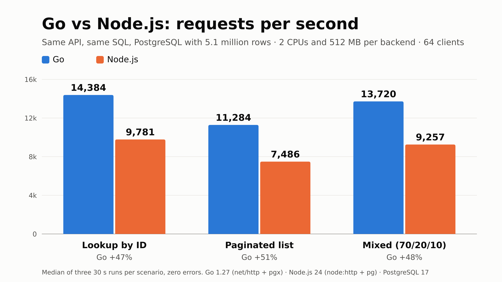

# Go vs Node.js: throughput with PostgreSQL

The same API written in Go and in Node.js/TypeScript, with the same SQL, the same database and the
same CPU and memory limits, to measure which one serves more requests per second.

|        | Go                 | Node.js                             |
| ------ | ------------------ | ----------------------------------- |
| HTTP   | `net/http`         | `node:http` + `cluster` (2 workers) |
| Driver | `pgx` (pool of 32) | `pg` (pool of 16 per worker)        |
| Limits | 2 CPUs, 512 MB     | 2 CPUs, 512 MB                      |

The database is a disposable PostgreSQL 17 with 5.1 million products and 100,000 inventory rows.

## Results



Median of three 30 s runs per combination, 72 runs in total, no failed requests.

| Scenario             | Clients | Go (req/s) | Node (req/s) | Difference |  Go p99 | Node p99 |
| -------------------- | ------: | ---------: | -----------: | ---------: | ------: | -------: |
| Lookup by ID (`pk`)  |      16 |     13,903 |        9,899 |       +40% |  2.3 ms |   2.9 ms |
| Lookup by ID (`pk`)  |      64 |     14,384 |        9,781 |       +47% |  8.9 ms |  11.6 ms |
| Lookup by ID (`pk`)  |     256 |     14,437 |        8,978 |       +61% | 24.6 ms |  49.0 ms |
| List (`list`)        |      16 |     11,034 |        7,407 |       +49% |  3.1 ms |   4.6 ms |
| List (`list`)        |      64 |     11,284 |        7,486 |       +51% | 11.5 ms |  15.1 ms |
| List (`list`)        |     256 |     11,422 |        6,639 |       +72% | 31.0 ms |  59.3 ms |
| Mixed (`mixed`)      |      16 |     13,184 |        9,125 |       +44% |  3.0 ms |   3.6 ms |
| Mixed (`mixed`)      |      64 |     13,720 |        9,257 |       +48% |  9.3 ms |  12.6 ms |
| Mixed (`mixed`)      |     256 |     14,396 |        8,704 |       +65% | 24.8 ms |  50.4 ms |
| No database (`json`) |      16 |     30,609 |       25,833 |       +18% |  1.3 ms |   1.4 ms |
| No database (`json`) |      64 |     32,630 |       27,434 |    +19% \* |  5.5 ms |   5.3 ms |
| No database (`json`) |     256 |     33,809 |       27,125 |    +25% \* | 17.9 ms |  19.3 ms |

\* The load generator hit its CPU limit: the number is a lower bound, not a measurement.

- Go served 40% to 72% more requests per second in the database scenarios, and 18% more without a
  database.
- The gap widens with concurrency. From 16 to 256 clients Go stays flat; Node loses up to 10% of
  its throughput and its p99 is twice Go's.
- In both cases the bottleneck is the backend's own CPU (both at ~200% of their 2 cores). The
  database, with 4 CPUs available, used ~1.9 under Go and ~1.2 under Node.
- Memory under load: ~20 MB for Go and ~70 MB for Node.

Full data in [`docs/results/runs.csv`](docs/results/runs.csv); environment and versions in
[`docs/results/metadata.json`](docs/results/metadata.json).

## Running it

Requires Docker and Node.js 24+ (used only by the scripts).

```bash
cp .env.example .env
docker compose up -d --build --wait --wait-timeout 1800   # seeding takes a few minutes
node scripts/smoke.mjs                                    # checks both APIs respond identically
node scripts/benchmark.mjs --quick                        # ~5 min; drop --quick for the full matrix
```

Go listens on `localhost:8081`, Node on `localhost:8082` and PostgreSQL on `localhost:5433`
(user, password and database are all `bench`). To throw everything away: `docker compose down -v`.

The matrix is configurable through environment variables: `WORKLOADS`, `VUS_LIST`, `REPEATS`,
`DURATION` and `WARMUP`. Each run writes `runs.csv` and the raw data to `results/<timestamp>/`; an
interrupted run can be continued with `--resume <timestamp>`.

## API

| Route                                                 | Operation                            |
| ----------------------------------------------------- | ------------------------------------ |
| `GET /health`                                         | Fixed JSON, no database              |
| `GET /products/:id`                                   | Primary key lookup                   |
| `GET /products?tenant_id=&category_id=&after=&limit=` | Keyset-paginated list                |
| `POST /inventory/:id/reserve`                         | Atomic stock decrement (`RETURNING`) |

The SQL lives in [`shared/queries.json`](shared/queries.json) and is read by both backends.

## Database

- `products_pkey (id)` for the point lookup.
- A partial covering index, `(tenant_id, category_id, id) INCLUDE (name, price_cents, stock) WHERE active`,
  for the list, which resolves as an index-only scan.
- Inventory lives in its own table with `fillfactor = 80`, so writes are HOT updates and do not
  invalidate the covering index.
- Seeded with `generate_series` inside the database, indexes built after the load and
  `VACUUM (ANALYZE, FREEZE)` at the end. See [`database/init.sql`](database/init.sql).
- `fsync` and `synchronous_commit` are on: writes are durable.

## Methodology

- Load is generated with [k6](https://k6.io) at fixed concurrency (`constant-vus`), on the same
  Docker network.
- One backend at a time; the other is stopped. The order alternates on every repetition.
- A warm-up precedes each measurement and tables and indexes are loaded with `pg_prewarm`:
  everything is in memory.
- Four scenarios: `json` (no database), `pk`, `list` and `mixed` (70% `pk`, 20% `list`, 10% writes).
- Each virtual user has a fixed-seed pseudo-random generator, so both backends receive the same
  request sequence.
- The runner records the CPU of the backend, the database and the generator. If the generator gets
  close to its limit, the run is flagged `generator_saturated` and is not valid for comparison.

## Limitations

- Everything runs on one machine, under Docker Desktop/WSL2. CPU limits are quotas, not dedicated
  cores, and there is noise between runs.
- Keys are uniformly distributed and the data set fits in memory. Real traffic has hotspots and
  disk reads.
- The result holds for these two implementations and these libraries, not for "the language".
  When the bottleneck is the database or the network, the gap between backends tends to disappear.

## License

[MIT](LICENSE)
